# Laporan Praktikum Intermediate Google Earth Engine

Clustering, Urban Sprawl, dan Flood Risk Modelling

| | |
| --- | --- |
| nama | Fathin Y |
| NIM | 241524041 |
| kelas | 3B |
| mata kuliah | Pengolahan Citra Digital, semester 5 |
| waktu pengerjaan | 9 Oktober 2026 |
| repository skrip | `users/vermilion10/praktikum-gee` |

---

## Tautan Skrip

Semua skrip disimpan terpisah per tsak di repository Code Editor

| skrip | isi | tautan get link |
| --- | --- | --- |
| `task0-uji-koneksi` | uji koneksi akun dan aset GDP/HDI | https://code.earthengine.google.com/df43b567459d37cdfd2f42905857997e |
| `task1` | filter citra dan clustering k-means | https://code.earthengine.google.com/bdd0d6445d52d7317efdc007906af6b4 |
| `task2` | cloud masking, komposit median, NDBI/NDWI | https://code.earthengine.google.com/7da4ab17fc9f7c6b7a6a68a977dcc0d6 |
| `task3` | urban sprawl 1990-2020, legenda, grafik luas | https://code.earthengine.google.com/d44ba9377b10ca820e2b9d82f38ce501 |
| `task4` | kerawanan banjir Batanghari | https://code.earthengine.google.com/85f4658cf9e980fa4536e5a04a1dcecb |
| `task5` | eksposur, kerentanan, risiko banjir | https://code.earthengine.google.com/2dea95e4ff2f0ca89b932dd598998ac8 |
| `tugas1` sampai `tugas4` | Tugas Praktikum Mandiri 1-4 | https://code.earthengine.google.com/f7bfb1798630f2b5d83789e2918e614a, https://code.earthengine.google.com/e2148987bd0ecc2fafb148f835e05111, https://code.earthengine.google.com/4187d0df2348ecc2647d1cb09d611e62, https://code.earthengine.google.com/d502ce058e9d278d5fcccc964d628b1a |
| `hotsAB` | soal HOTS A dan B | https://code.earthengine.google.com/7a137ce581c04efb6ac518c6c6f58d00 |

---

## Persiapan

Skrip uji koneksi di modul memanggil satu scene, `LC09_122065_20220119`, dan scene itu tidak ditemukan di katalog. error-nya bukan tanda akun bermasalah, jadi skrip uji diganti dengan filter koleksi yang tidak bergantung pada satu ID scene:

```js
var koleksi = ee.ImageCollection('LANDSAT/LC09/C02/T1_L2')
  .filterDate('2022-01-01', '2022-03-01')
  .limit(1);
print('Jumlah citra:', koleksi.size());
print('Band citra uji:', koleksi.first().bandNames());
```

Konsol menampilkan jumlah citra dan daftar band, jadi akun, project, dan katalog sudah bisa dipakai. Skrip yang sama juga membaca aset `GDP_PPP_1990_2015_5arcmin_v2` dan `HDI_1990_2015_v2` untuk Task V. Halaman GEE Community Catalog sekarang mendokumentasikan versi 3.0, tapi aset versi 2 yang dipakai modul masih terbaca dengan 26 band (1990-2015), jadi band `b26` untuk tahun 2015 tersedia

Urutan ketergantungan antarskrip: `task1` berdiri sendiri, `task2` mendefinisikan `roi`, `l8`, `cloudMask`, `median`, dan `bandMap`, `task3` butuh `roi` dan `l8` dari Task II, `task4` memakai ROI Batanghari dan fungsi `cloudMask` yang disalin dari Task II, sementara `task5` adalah isi `task4` ditambah kode Task V (dibuat lewat Save as supaya `task4` tetap utuh).

---

## Task I: Filter Citra dan Clustering Tutupan Lahan

### Kode dan Penjelasan

```js
var dataset = ee.ImageCollection('LANDSAT/LC09/C02/T1_L2');
var geometry = ee.Geometry.Point([112.05730244401117, -6.897418238470722]);

dataset = dataset
  .filterBounds(geometry)
  .filterMetadata('CLOUD_COVER_LAND', 'less_than', 50)
  .sort('CLOUD_COVER_LAND');

print('CLOUD_COVER_LAND:', dataset.first().get('CLOUD_COVER_LAND'));
var img = dataset.first();
```

`filterBounds` mengambil scene yang menutup titik kajian, `filterMetadata` membuang scene dengan tutupan awan darat di atas 50%, dan `sort` mengurutkan dari yang paling bersih. ketiganya bekerja di metadata, belum menyentuh piksel, jadi `first()` langsung mendapat citra terbaik. Citra terpilih punya `CLOUD_COVER_LAND` 0,06.

```js
var band = ['SR_B1', 'SR_B2', 'SR_B3', 'SR_B4', 'SR_B5', 'SR_B6', 'SR_B7'];
var img_pilih = img.select(band).clip(geometry2);

var data_training = img_pilih.sample({region: geometry2, scale: 30, numPixels: 500});
var cluster_model = ee.Clusterer.wekaKMeans(15).train(data_training);
var hasil = img_pilih.cluster(cluster_model);

// modul: hasil.eq(2).or(hasil.eq(3)); diganti sesudah verifikasi
var lahan_terbangun = hasil.eq(9).or(hasil.eq(11)).selfMask();
```

`sample` mengambil 500 piksel acak di poligon kajian sebagai bahan latih, `wekaKMeans(15)` membentuk 15 kelompok berdasarkan jarak spektral di tujuh band, lalu `cluster` menempelkan nomor kelompok ke tiap piksel. `selfMask()` menyembunyikan piksel bernilai 0 supaya yang tampil hanya kandidat bangunan. Untuk memilih cluster, skrip menambahkan layer `hasil.randomVisualizer()` (tidak ada di modul) supaya peta cluster mentahnya bisa dibandingkan dengan citra asli.

### Verifikasi Cluster

Nomor 2 dan 3 dari modul tidak cocok di run ini. Statistik per cluster di `geometry2` dan cek visual di atas layer `Data paling bersih`:

| cluster | rata rata NDBI | rata rata NDVI | piksel | hasil cek visual |
| --- | --- | --- | --- | --- |
| 2 (bawaan modul) | −0,163 | 0,359 | 2243 | vegetasi, bukan bangunan |
| 3 (bawaan modul) | 0,015 | 0,169 | 3012 | bercak besar di sawah atau lahan kering |
| 5 | 0,010 | 0,200 | 4323 | tanah terbuka di sawah |
| 9 (dipilih) | 0,058 | 0,110 | 323 | titik terang di dalam kota (atap) |
| 10 | 0,043 | 0,137 | 2496 | campuran kota dan lahan terbuka, tidak dipakai |
| 11 (dipilih) | 0,031 | 0,154 | 5205 | mengumpul di pusat kota dan permukiman |

Atap dan aspal memantulkan SWIR lebih tinggi dari NIR (NDBI positif) dan hampir tanpa vegetasi (NDVI rendah). tanah kering juga ber-NDBI positif, jadi cluster yang bercaknya jatuh di sawah dibuang walau angkanya mirip.

Catatan lokasi: poligon kajian modul (111,57-111,62 BT; 7,13-7,18 LS) jatuh di Cepu, di tepi Bengawan Solo, bukan di Purwodadi. Label peta di Code Editor yang menunjukkan ini, jadi laporan memakai nama Cepu

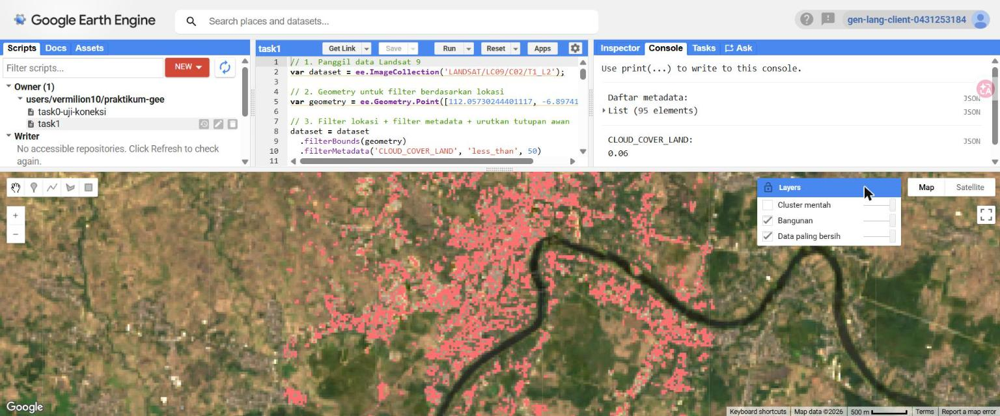

Gambar 1. Hasil akhir clustering lahan terbangun, layer `Bangunan` (cluster 9 dan 11) di atas `Data paling bersih`

### Lesson Learnt Task I

Clustering k-means mengelompokkan piksel tanpa data latih, tapi nomor cluster hasilnya tidak punya arti apa apa sebelum dicocokan ke citra. Modul memakai `hasil.eq(2).or(hasil.eq(3))` sebagai lahan terbangun, sementara di run ini cluster 2 punya rata rata NDBI −0,163 dan NDVI 0,359, jadi isinya vegetasi. cluster 3 juga meleset, bercaknya jatuh di sawah dan lahan kering. Kalau nomor dari modul dipakai begitu saja, layer `Bangunan` terlihat masuk akal sekilas walau sebagian merahnya bukan bangunan

---

## Task II: Komposit Median, Indeks Spektral, dan Pemetaan Lahan Terbangun

### Kode dan Penjelasan

```js
function cloudMask(image) {
  var qa = image.select('QA_PIXEL');
  var dilated = 1 << 1;   // bit 1: awan melebar
  var cirrus  = 1 << 2;   // bit 2: cirrus
  var cloud   = 1 << 3;   // bit 3: awan
  var shadow  = 1 << 4;   // bit 4: bayangan awan
  var mask = qa.bitwiseAnd(dilated).eq(0)
    .and(qa.bitwiseAnd(cirrus).eq(0))
    .and(qa.bitwiseAnd(cloud).eq(0))
    .and(qa.bitwiseAnd(shadow).eq(0));
  var rename = image.select(
    ['SR_B2', 'SR_B3', 'SR_B4', 'SR_B5', 'SR_B6', 'SR_B7'],
    ['B2', 'B3', 'B4', 'B5', 'B6', 'B7']);
  var scaled = rename.multiply(0.0000275).add(-0.2);
  return scaled.updateMask(mask);
}

var median = filtered.map(cloudMask).median().clip(roi);
```

Band `QA_PIXEL` menyimpan status tiap piksel sebagai bit. `1 << 3` menggeser angka 1 tiga posisi jadi 8, yaitu bit awan, dan `bitwiseAnd(cloud).eq(0)` bernilai 1 kalau bit itu mati. empat syarat dirangkai dengan `.and()`, jadi piksel lolos hanya kalau keempat bit mati, lalu `updateMask` menutup piksel yang gagal (jadi kosong, bukan nol). `multiply(0.0000275).add(-0.2)` adalah faktor skala resmi USGS Collection 2 untuk mengubah UInt16 ke reflektansii 0 sampai 1, dan nama band diseragamkan ke B2-B7 supaya rumus indeks yang sama bisa dipakai lagi di Task III.

`median()` mengambil nilai tengah tiap piksel dari seluruh citra 2022 yang sudah dimasking. Sisa awan yang lolos mask hanya muncul di sebagian kecil citra, jadi kalah dari nilai tengah, sementara mean masih ikut tertarik.

```js
var bandMap = {NIR: median.select('B5'), SWIR: median.select('B6'), GREEN: median.select('B3')};
var ndbi = median.expression('(SWIR - NIR) / (SWIR + NIR)', bandMap);
var ndwi = median.expression('(GREEN - NIR) / (GREEN + NIR)', bandMap);

var air = ndwi.gt(0.1);
var bangunan = ndbi.gt(-0.1).and(air.eq(0));
```

`expression` menulis rumus indeks seperti di buku, dan `bandMap` menerjemahkan nama variabel ke band. `ndwi.gt(0.1)` menghasilkan peta biner air, lalu `bangunan` mensyaratkan NDBI > −0,1 dan bukan air. syarat kedua perlu karena laut juga ber-NDBI positif, terlihat merah di layer NDBI pada Gambar 3

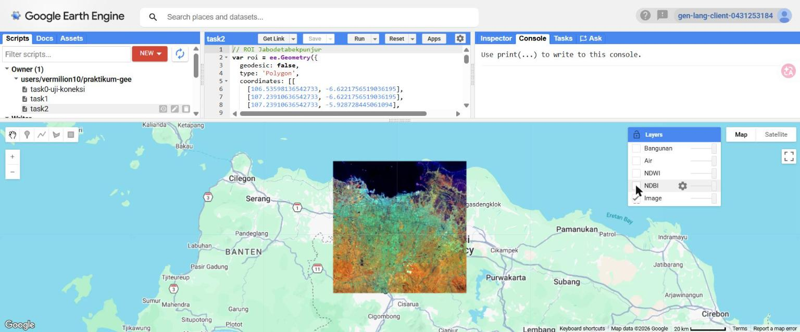

Gambar 2. Komposit median 2022 Jabodetabekpunjur. Daftar gambar modul menulis "SWIR-NIR-Biru", tapi kode modul memakai band `['B5', 'B6', 'B2']`, yaitu NIR-SWIR-Biru, dan gambar ini mengikuti kode

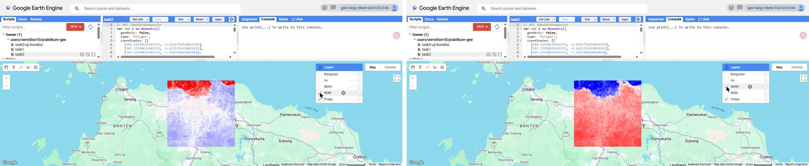

Gambar 3. NDBI (kiri) dan NDWI (kanan) pada area dan zoom yang sama

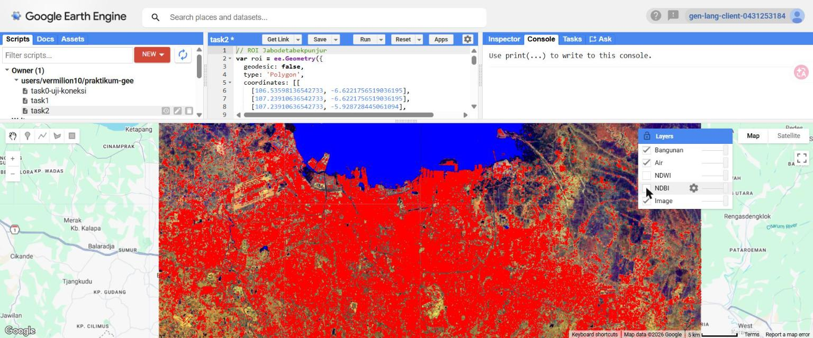

Gambar 4. Layer `Air` (biru) dan `Bangunan` (merah) di pesisir Jakarta

### Kalibrasi Ambang

Kalibrasi dilakukan dua cara. Yang pertama memakai ESA WorldCover v200 sebagai acuan di seluruh ROI pada skala 60 m, persentase piksel tiap kelas yang lolos ambang:

| kelas WorldCover | NDBI > −0,15 | NDBI > −0,10 | NDBI > −0,05 | NDBI > 0 | NDWI > 0,1 |
| --- | --- | --- | --- | --- | --- |
| 10 pohon | 13% | 7% | 3% | 1% | 0% |
| 30 rumput | 34% | 18% | 8% | 3% | 0% |
| 40 pertanian | 14% | 6% | 2% | 0% | 0% |
| 50 terbangun | 89% | 78% | 63% | 46% | 0% |
| 60 lahan terbuka | 80% | 68% | 46% | 19% | 0% |
| 80 air | 2% | 1% | 1% | 0% | 86% |

| ambang NDBI | presisi (yang lolos memang kelas 50) | recall kelas 50 |
| --- | --- | --- |
| > −0,15 | 77% | 89% |
| > −0,10 (modul) | 85% | 78% |
| > −0,05 | 91% | 63% |
| > 0 | 96% | 46% |

WorldCover sendiri hasil klasifikasi tahun 2021, jadi angka di atas perkiraan, bukan kebenaran lapangan.

Cara kedua lewat Inspector di sekitar Ragunan dan Jakarta Selatan. Tiap titik dicek ulang di basemap Satellite dan hanya titik yang jelas yang dipakai:

| titik | koordinat | di citra satelit | NDBI | NDWI | lolos `Bangunan`? |
| --- | --- | --- | --- | --- | --- |
| T1 | 106.86540, −6.28235 | permukiman padat | 0,076 | −0,391 | ya |
| T2 | 106.85682, −6.33354 | permukiman padat | 0,139 | −0,257 | ya |
| T3 | 106.84223, −6.31733 | permukiman padat tepi sungai | 0,103 | −0,356 | ya |
| T4 | 106.91573, −6.29348 | permukiman padat (komp. ardhini) | 0,076 | −0,312 | ya |
| T5 | 106.86234, −6.28717 | permukiman padat | 0,151 | −0,206 | ya |
| V1 | 106.82163, −6.31136 | hutan ragunan | −0,343 | −0,682 | tidak |
| V2 | 106.81994, −6.30935 | hutan ragunan | −0,336 | −0,702 | tidak |
| V3 | 106.91089, −6.32501 | taman hijau besar | −0,398 | −0,685 | tidak |
| V4 | 106.88929, −6.28427 | lapangan golf | −0,299 | −0,469 | tidak |
| V5 | 106.90818, −6.32812 | tepi taman berumput | −0,107 | −0,551 | tidak |

Kesepuluh titik terpisah benar dengan ambang −0,1, jadi ambang modul (NDBI > −0,1, NDWI > 0,1) dipertahankan dan kode `task2` tidak diubah. titik yang dibuang karena tidak tegas di citra satelit: permukiman jarang bercampur pohon (NDBI −0,268 dan −0,176), lahan campuran (0,010 dan −0,162), dan Situ Gintung (106.76275, −6.30453) yang tampak hijau di basemap dengan NDWI hanya 0,075

### Lesson Learnt Task II

NDBI tidak bisa dipakai sendiri karena laut juga punya NDBI positif, dan mask `air.eq(0)` yang membuangnya dari peta `Bangunan`. Situ Gintung punya NDWI hanya 0,075 dan tidak masuk layer `Air`, kemungkinan karena permukaannya tertutup vegtasi. Komposit `median()` dari setahun citra Landsat 8 membuat seluruh ROI tampil tanpa lubang awan walau satu citra saja jarang bebas awan

---

## Task III: Iterasi Multitemporal dan Peta Urban Sprawl

### Kode dan Penjelasan

Latihan iterasi di langkah 1 menjalankan `for` (di komputer sendiri) dan `Array.map` untuk mengubah tiap unsur tanpa salin tempel. Konsol menampilkan 0 sampai 29, `[Ahmad Keren, Agung Keren, Andi Keren]`, dan `[A, B]`.

Kode Task III memakai `l8` yang hanya didefinisikan di Task II, jadi kalau dijalankan sebagai skrip terpisah muncul error. `task3` menambahkan baris ini di atas, ditambah salinan `roi` dari Task II:

```js
var l8 = ee.ImageCollection('LANDSAT/LC08/C02/T1_L2');
```

Dua fungsi cloud mask dipakai karena urtan band Landsat 4-7 (TM/ETM+) berbeda dari Landsat 8-9 (OLI). di TM, SWIR ada di `SR_B5` dan tidak ada bit cirrus, di OLI SWIR pindah ke `SR_B6`. Keduanya menyeragamkan hasilnya ke B2-B7:

```js
function cloudMaskTm(image) {
  var qa = image.select('QA_PIXEL');
  var mask = qa.bitwiseAnd(1 << 1).eq(0)
    .and(qa.bitwiseAnd(1 << 3).eq(0))
    .and(qa.bitwiseAnd(1 << 4).eq(0));
  return image
    .select(['SR_B1', 'SR_B2', 'SR_B3', 'SR_B4', 'SR_B5', 'SR_B7'],
            ['B2', 'B3', 'B4', 'B5', 'B6', 'B7'])
    .updateMask(mask);
}
```

`landsat457` menggabungkan koleksi Landsat 4, 5, dan 7 dengan `merge` lalu membuat komposit median, `landsat89` melakukan hal yang sama untuk Landsat 8 dan 9. Di dalam `yearList.map`, `(year < 2014) ? landsat457 : landsat89` memilih fungsi di sisi klien.

```js
var built = ee.Image(0)
  .where(ndbiTahun.gt(-0.1).and(mndwi.lte(0)), year)
  .selfMask()
  .clip(roi);

// modul: built.multiply(...); diganti karena nilai piksel built adalah tahun
var area = built.gt(0).multiply(ee.Image.pixelArea().multiply(0.0001)).rename('area');

return built.toUint16().rename('built')
  .addBands(area)
  .set('year', year, 'system:time_start', start);
```

`ee.Image(0).where(syarat, year)` mengecat piksel terbangun dengan tahun deteksinya. MNDWI dipakai sebagai penyaring air karena lebih tahan terhadap latar terbangun (Xu, 2006). `pixelArea()` memberi luas piksel dalam m², dikali 0,0001 jadi hektar.

```js
var urbanExpansion = builtCol.select('built').min().set(dict);
```

`min()` lintas tahun menyimpan nilai terkecil tiap piksel, yaitu tahun pertama piksel itu terbangun, jadi satu peta merangkum seluruh sejarah ekspansi. `dict` memberi palet tujuh warna lewat properti `built_class_values` dan `built_class_palette`, legendanya dirangkai dari `ui.Panel` dan `ui.Label(String(year))`, dan grafik luas dibuat dengan `ui.Chart.image.series(builtCol.select('area'), roi, ee.Reducer.sum(), 30, 'year')`. sumbu X grafik diberi `format: '####'` supaya tahun tidak tertulis "1,990".

### Bug Band Luas di Kode Modul

Kode modul menulis `built.multiply(ee.Image.pixelArea().multiply(0.0001))`. Nilai piksel `built` adalah tahun (1990, 1995, dan seterusnya), jadi luas tiap piksel ikut terkali sekitar 2000. Versi modul memberi 143 juta Ha untuk 1990, padahal seluruh ROI Jabodetabekpunjur hanya sekitar 600 ribu Ha. Dengan `built.gt(0).multiply(...)` hasilnya:

| tahun | luas terbangun (Ha) | jumlah citra di koleksi | sensor |
| --- | --- | --- | --- |
| 1990 | 72.060 | 21 | landsat 4/5/7 (TM/ETM+) |
| 1995 | 84.916 | 45 | landsat 4/5/7 |
| 2000 | 142.223 | 47 | landsat 4/5/7 |
| 2005 | 132.575 | 69 | landsat 4/5/7 |
| 2010 | 132.175 | 31 | landsat 4/5/7 |
| 2015 | 235.512 | 41 | landsat 8/9 (OLI) |
| 2020 | 180.747 | 45 | landsat 8/9 |

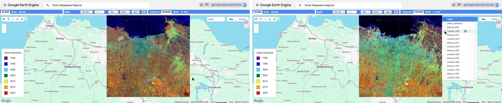

Gambar 5. Komposit Landsat 1990 (kiri) dan 2020 (kanan). Nama berkas mengikuti modul, termasuk "lansat"

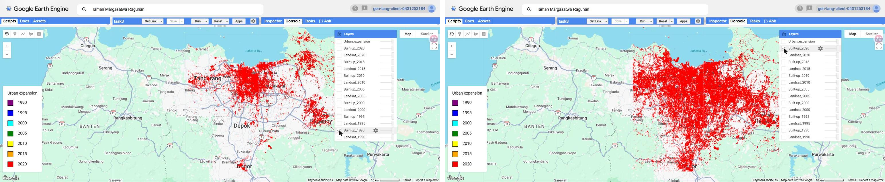

Gambar 6. `Built-up_1990` (kiri) dan `Built-up_2020` (kanan)

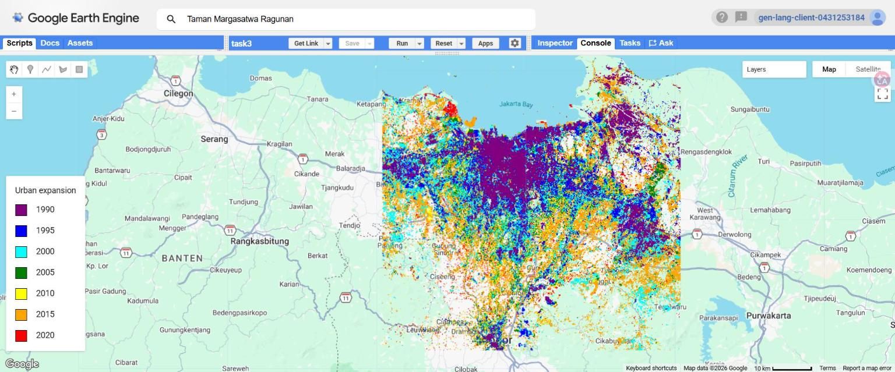

Gambar 7. `Urban_expansion` dengan legenda tahun ekspansi

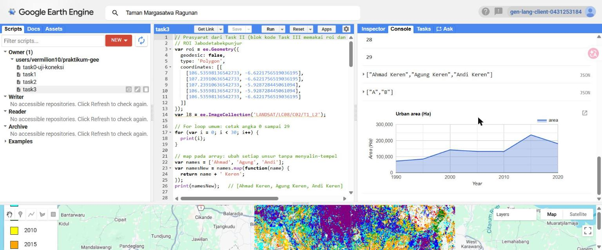

Gambar 8. Grafik "Urban area (Ha)" sesudah bug band luas diperbaiki

### Lesson Learnt Task III

Satu fungsi di dalam `yearList.map` cukup untuk membuat tujuh komposit dari lima satelit, dan pilihan sensornya ditentukan `year < 2014` di sisi klien

---

## Task IV: Pemodelan Kerawanan Banjir (Hazard)

### Kode dan Penjelasan

Komposit dibuat dengan resep Task II pada ROI Batanghari, dan fungsi `cloudMask` disalin ke skrip `task4` karena kode modul memakainya tanpa mendefinisikan ulang.

```js
var ndwi = image.expression('(GREEN - NIR) / (GREEN + NIR)', bandMap);
var air = ndwi.gt(0.1);
var bukanAir = air.eq(0);

var jarakAir = air.fastDistanceTransform()
  .sqrt().multiply(30)
  .updateMask(bukanAir)
  .clip(roi)
  .reproject('EPSG:4326', null, 30);

var harkatJarakAir = jarakAir.where(jarakAir.gt(200), 1)
  .where(jarakAir.gt(150).and(jarakAir.lte(200)), 2)
  .where(jarakAir.gt(100).and(jarakAir.lte(150)), 3)
  .where(jarakAir.gt(50).and(jarakAir.lte(100)), 4)
  .where(jarakAir.lte(50), 5);
```

`fastDistanceTransform()` mengeluarkan jarak kuadrat dalam satuan piksel, jadi `sqrt().multiply(30)` mengubahnya ke metr supaya ambang 50-200 m di Tabel 4 bermakna. `reproject` mengunci perhitungan di grid 30 m supaya nilainya tidak berubah ikut zoom. Rantai `.where(kondisi, nilai)` menimpa nilai jarak dengan harakt 1 sampai 5. `task4` menambahkan satu `Map.addLayer(ndwi, ...)` karena Gambar 10 meminta layer NDWI, sementara kode modul hanya menampilkan `Air`.

```js
var srtm = ee.Image('USGS/SRTMGL1_003').clip(roi).updateMask(bukanAir);
var tpi = srtm.subtract(srtm.focalMean(3))
  .reproject('EPSG:4326', null, 30)
  .updateMask(bukanAir)
  .clip(roi);
```

TPI adalah elevasi dikurangi rata rata elevasi lingkungan radius 3 piksel. nilai negatif berarti lebih rendah dari sekitarnya (cekungan), positif berarti punggungan. `updateMask(bukanAir)` membuang sungai dari analisis topografi supaya alur sungai tidak ikut dinilai cekungan.

```js
var ndvi = image.expression('(NIR - RED) / (NIR + RED)', bandMap).updateMask(bukanAir);
// harkat NDVI kelas 5: ndvi.lte(-0.25), koreksi Lampiran A modul

var kerawanan = harkatJarakAir.add(harkatElevasi).add(harkatTPI).add(harkatNDVI);
var harkatKerawanan = kerawanan.where(kerawanan.gt(16), 5)
  .where(kerawanan.gt(12).and(kerawanan.lte(16)), 4)
  .where(kerawanan.gt(8).and(kerawanan.lte(12)), 3)
  .where(kerawanan.gt(4).and(kerawanan.lte(8)), 2)
  .where(kerawanan.lte(4), 1);
```

Empat harkat dijumlahkan jadi 4 sampai 20, lalu diharkat ulang ke lima kelas. penjumlahan ini setara weighted overlay dengan bobot seragam.

### Sebaran Kelas

Sebaran kelas di ROI pada skala 30 m:

| layer | kelas 1 | kelas 2 | kelas 3 | kelas 4 | kelas 5 |
| --- | --- | --- | --- | --- | --- |
| harkat jarak air | 93,6% | 1,5% | 1,8% | 1,8% | 1,2% |
| harkat elevasi | 45,2% | 16,8% | 20,7% | 16,1% | 1,2% |
| harkat TPI | 49,1% | 8,2% | 6,7% | 6,2% | 29,8% |
| harkat NDVI | 83,9% | 12,9% | 2,7% | 0,5% | 0,0% |
| harkat kerawanan | 20,0% | 52,6% | 25,1% | 1,8% | 0,4% |

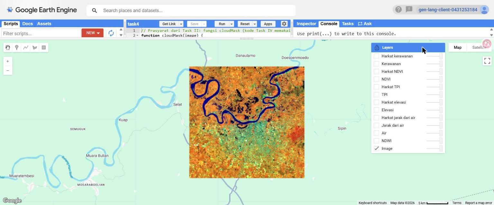

Gambar 9. Komposit Landsat 8 2022, ROI Batanghari

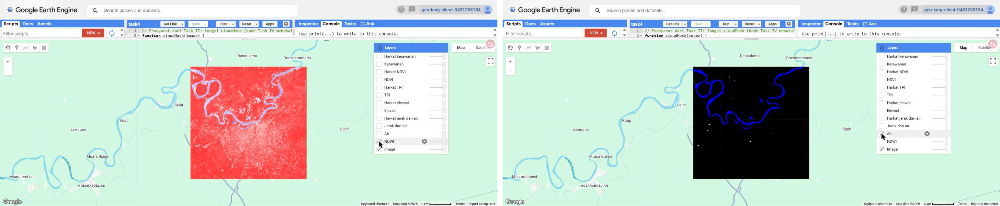

Gambar 10. NDWI (kiri) dan `Air` (kanan)

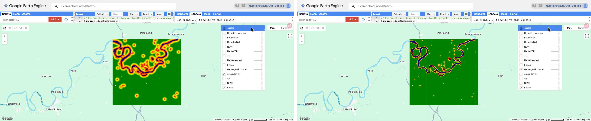

Gambar 11. `Jarak dari air` (kiri) dan `Harkat jarak dari air` (kanan)

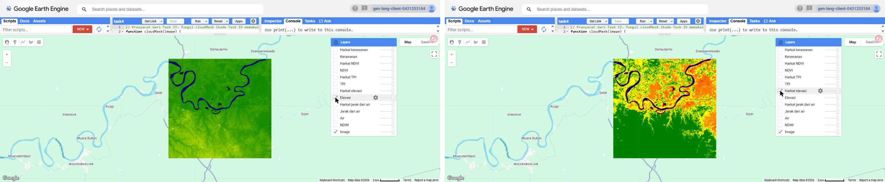

Gambar 12. `Elevasi` SRTM (kiri) dan `Harkat elevasi` (kanan)

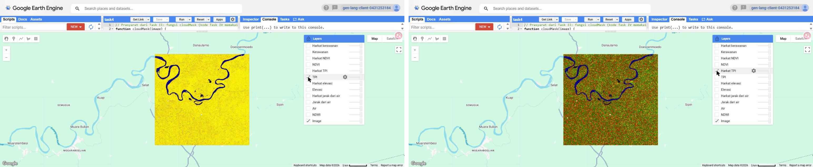

Gambar 13. `TPI` (kiri) dan `Harkat TPI` (kanan)

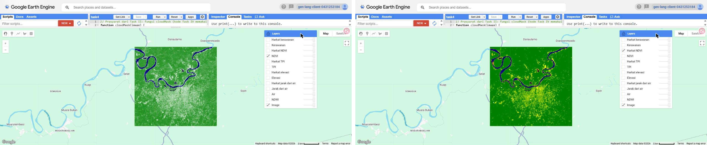

Gambar 14. `NDVI` (kiri) dan `Harkat NDVI` (kanan)

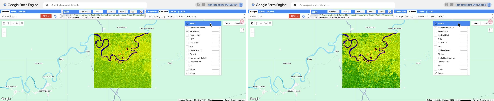

Gambar 15. `Kerawanan` (jumlah 4-20, kiri) dan `Harkat kerawanan` (kanan)

### Lesson Learnt Task IV

empat variabel dengan satuan berbeda (meter jarak, meter elevasi, TPI, dan NDVI) baru bisa dijumlahkan sesudah semuanya diharkat ke skala 1 sampai 5, dan hasil penjumlahannya sangat bergantung pada ambang tiap variabel. Di ROI Batanghari harkat jarak air hampir seragam, 93,6% piksel ada di kelas 1, jadi variabel ini hanya membedakan pita tipis di tepi sungai

---

## Task V: Eksposur, Kerentanan, dan Risiko Banjir

### Kode dan Penjelasan

```js
var penduduk = ee.ImageCollection('JRC/GHSL/P2023A/GHS_POP')
  .sort('system:time_start', false)
  .first().updateMask(bukanAir).clip(roi);
```

`sort('system:time_start', false)` mengurutkan epok dari yang terbaru, jadi `first()` mengambil data penduduk GHSL paling akhir. harkatnya mengikuti Tabel 6 dengan arah biasa: makin banyak penduduk, makin tinggi harkat.

```js
var wc = ee.ImageCollection('ESA/WorldCover/v200').first().clip(roi).updateMask(bukanAir);
var lahanTerbangun = wc.eq(50);   // kelas 50 = built-up
var pertanian = wc.eq(40);        // kelas 40 = cropland

var lahanTerbangunArea = lahanTerbangun.multiply(area)
  .reduceResolution(ee.Reducer.sum(), true)
  .reproject('EPSG:4326', null, 30);
```

WorldCover menyimpan kode kelas, jadi `eq(50)` dan `eq(40)` memberi peta biner terbangun dan pertanian. Maksud modul, `reduceResolution` dengan `sum` menjumlahkan luas piksel 10 m di dalam tiap sel 30 m. `task5` menambahkan tiga `Map.addLayer` (`Harkat lahan terbangun`, `Luas pertanian`, `Harkat pertanian`) karena Gambar 17 dan 18 memintanya, sementara kode modul hanya menampilkan `Luas lahan terbangun`.

```js
var harkatPDB = pdb.where(pdb.gt(40 * 1e6), 1)
  .where(pdb.gt(30 * 1e6).and(pdb.lte(40 * 1e6)), 2)
  .where(pdb.gt(20 * 1e6).and(pdb.lte(30 * 1e6)), 3)
  .where(pdb.gt(10 * 1e6).and(pdb.lte(20 * 1e6)), 4)
  .where(pdb.lte(10 * 1e6), 5);

var risiko = harkatKerawanan.add(harkatEksposur);   // .add(harkatKerentanan);
```

Arah harkat PDB dan IPM dibalik dari variabel fisik: nilai tinggi diberi harkat 1, karena kemampuan ekonomi dan kualitas manusia yang tinggi menurunkan kerentanan. band `b26` adalah tahun 2015. Risiko versi modul hanya menjumlahkan kerawanan dan eksposur (2 sampai 10) dan memakai ambang 2/4/6/8, versi tiga komponen dikerjakan di Tugas 4.

### Bug `reduceResolution` di Kode Modul

Nilai maksimum `lahanTerbangunArea` di ROI hanya 85,45 m², kira kira luas satu piksel WorldCover 10 m, bukan sekitar 900 m² untuk sel 30 m. jadi `reduceResolution(ee.Reducer.sum(), true)` tidak menjumlahkan sembilan piksel seperti yang dijelaskan modul. Empat cara diuji:

| cara | luas maksimum per sel 30 m | catatan |
| --- | --- | --- |
| kode modul (`sum` berbobot) | 85,45 m² | setara satu piksel 10 m |
| `reproject` ke proyeksi WorldCover dulu, lalu `sum` | 85,45 m² | tidak berubah |
| `sum().unweighted()` | 2.136 m² | lebih besar dari luas sel, menghitung ganda |
| fraksi `mean` × `pixelArea()` | 893,7 m² | cocok dengan sel 30 × 30 m |

Cara yang memberi angka masuk akal:

```js
lahanTerbangun.unmask(0)
  .reduceResolution({reducer: ee.Reducer.mean(), maxPixels: 1024})
  .reproject('EPSG:4326', null, 30)
  .multiply(ee.Image.pixelArea());
```

Kode `task5` sengaja tidak diubah supaya angka di bawah bisa dibandingkan dengan kode modul. Perbaikannya hanya diuji untuk melihat besar luas yang seharusnya

### Sebaran Kelas

Sebaran kelas di ROI pada skala 30 m, kode modul apa adanya:

| layer | kelas 1 | kelas 2 | kelas 3 | kelas 4 | kelas 5 |
| --- | --- | --- | --- | --- | --- |
| harkat penduduk | 79,8% | 13,2% | 6,4% | 0,6% | 0,0% |
| harkat lahan terbangun | 87,2% | 2,3% | 2,8% | 7,7% | 0% |
| harkat pertanian | 95,8% | 0,7% | 0,8% | 2,7% | 0% |
| harkat eksposur | 74,6% | 16,8% | 8,5% | 0,0% | 0% |
| harkat PDB | 91,8% | 2,7% | 4,4% | 1,1% | 0% |
| harkat IPM | 0% | 0% | 0% | 100% | 0% |
| harkat kerentanan | 0% | 0% | 94,5% | 5,5% | 0% |
| harkat risiko | 16,6% | 68,3% | 14,8% | 0,2% | 0% |

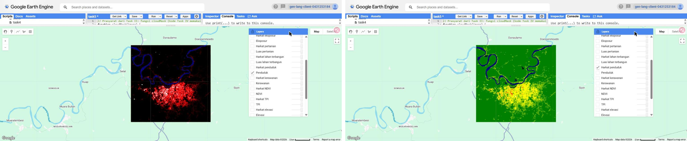

Gambar 16. `Penduduk` GHSL (kiri) dan `Harkat penduduk` (kanan)

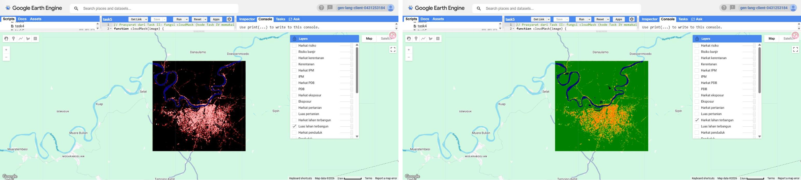

Gambar 17. `Luas lahan terbangun` (kiri) dan `Harkat lahan terbangun` (kanan)

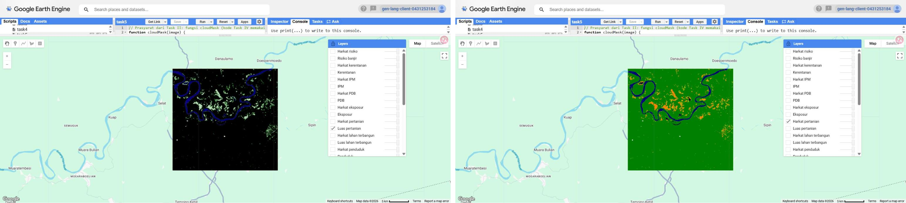

Gambar 18. `Luas pertanian` (kiri) dan `Harkat pertanian` (kanan)

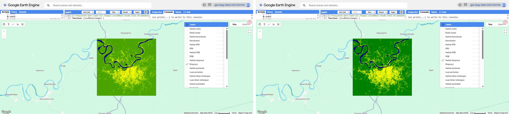

Gambar 19. `Eksposur` (kiri) dan `Harkat eksposur` (kanan)

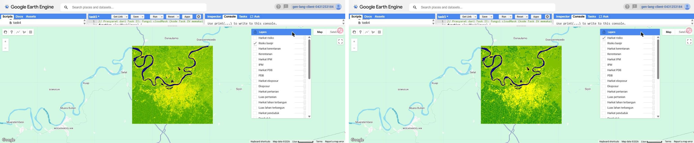

Gambar 20. `Risiko banjir` (kiri) dan `Harkat risiko` (kanan). Kode modul tidak membuat panel legenda untuk kelas risiko, jadi palet hijau, kuning, merah di gambar ini dibaca kelas 1 sampai 5

### Lesson Learnt Task V

arah harkat pdb dan ipm dibalik dari variabel fisik: nilai tinggi diberi harkat 1 karena kemampuan ekonomi dan kualitas manusia yang tinggi menurunkan kerentanan. Di ROI Batanghari arah itu hampir tidak berpengaruh, karena IPM jatuh di satu kelas untuk seluruh ROI dan kerentanan 94,5% di kelas 3. Data PDB dan IPM beresolusi sekitar 5 km, jadi satu sel sudah menutup sebagian besar kota


### Pembahasan Asumsi Ambang dan Keterbatasan Resolusi

Model risiko modul bergantung pada empat jenis asumsi, dan di ROI Batanghari masing masing punya efek yang terukur.

Ambang tiap variabel. Ambang jarak dari air berhentii di 200 m, jadi 93,6% ROI jatuh di kelas 1 dan variabel ini hanya membedakan pita tipis di tepi sungai. ambang TPI berselisih 0,25 m padahal SRTM bernilai meter bulat, jadi kelas 2 sampai 4 hampir kosong. Ambang luas lahan terbangun dan pertanian (40 sampai 100 m²) dibuat untuk satuan yang dihasilkan kode, dan dengan luas yang benar ambang itu setara hanya 4 sampai 11% isi sel 30 m, jadi hampir semua sel kota akan masuk kelas 5. Kalau bug luasnya diperbaiki, ambangnya ikut perlu ditinjau

Batas kelas pada tabel penjumlahan. Tabel 5, 7, dan 9 memberi kelas 1 untuk jumlah di bawah nilai minimum yang mungkin (di bawah 4 untuk empat variabel, di bawah 3 untuk tiga variabel, di bawah 2 untuk dua variabel), jadi kelas 1 versi tabel tidak pernah terisi. Kode memakai `lte`, jadi jumlah minimum ikut masuk kelas 1. Di Task IV ini berarti 20% piksel yang di kode berkelas 1 menurut Tabel 5 seharusnya kelas 2. Tabel 10 juga dibuat untuk tiga komponen (jumlah 3 sampai 15), sementara kode risiko modul menjumlahkan dua komponen dan memakai ambang 2/4/6/8. kode tidak diubah, dan perbedaannya dicatat di sini.

Bobot. Penjumlahan harkat memberi bobot sama ke semua variabel, tapi sebaran harkatnya tidak sama: harkat jarak air 93,6% kelas 1, sementara harkat elevasi tersebar di kelas 1 sampai 4 dan harkat TPI terbelah ke kelas 1 dan 5. dengan bobot sama, variabel yang sebarannya lebar lebih banyak menggeser jumlah harkat daripada jarak air. Pengaruh bobot lain belum diuji

Resolusi. Variabel fisik dihitung di grid 30 m, penduduk GHSL sekitar 100 m, dan PDB/IPM sekitar 5 km. GEE menurunkan data kasar ke grid 30 m tanpa menambah informasi, jadi IPM bernilai satu kelas untuk seluruh ROI dan kerentanan 94,5% kelas 3. di Tugas 4 komponen kerentanan menambahkan blok persegi seukuran sel 5 km ke peta risiko. Untuk ROI seukuran kota, pembeda risiko hampir seluruhnya datang dari kerawanan dan eksposur

---

## Tugas Praktikum Mandiri

### Tugas 1: Sensitivitas Clustering

Skrip `tugas1` mengulang Task I dengan k = 5, 10, 15, dan 20, masing masing dengan tiga seed. Modul hanya meminta 5, 10, dan 20; k = 15 ditambahkan sebagai pembanding karena itu nilai bawaan Task I. Supaya 12 percobaan dinilai dengan aturan yang sama, cluster kandidat terbangun adalah cluster yang lebih dari 50% pikselnya ditandai terbangun oleh ESA WorldCover. Luasnya dihitung dengan `reduceRegion` + `ee.Reducer.sum()` pada `pixelArea()` di `geometry2`.

```js
var luasPiksel = ee.Image.pixelArea().divide(1e4).rename('ha');
// ...
var mask = hasil.remap(dipilih, ee.List.repeat(1, dipilih.size()), 0).rename('m');
var luas = mask.multiply(luasPiksel).reduceRegion({
  reducer: ee.Reducer.sum(), geometry: geometry2, scale: 30, maxPixels: 1e9
}).get('m');
```

`dipilih` adalah daftar cluster yang lolos aturan WorldCover, dan `remap` mengubah cluster terpilih jadi 1 dan sisanya 0 sebelum luasnya dijumlahkan.

| k | seed 10 (bawaan) | seed 1 | seed 2 |
| --- | --- | --- | --- |
| 5 | 45,2 Ha, cluster [4] | 346,9 Ha, [1] | 41,2 Ha, [3] |
| 10 | 554,4 Ha, [4, 9] | 779,4 Ha, [1, 6, 9] | 696,0 Ha, [3, 4, 6] |
| 15 | 722,6 Ha, [9, 10, 11] | 615,4 Ha, [1, 6, 14] | 639,5 Ha, [3, 4, 6, 12] |
| 20 | 599,1 Ha, [9, 11, 19] | 485,3 Ha, [6, 14, 15] | 603,6 Ha, [3, 4, 6, 12] |

IoU terhadap k = 15 seed 10: k = 5 hanya 0,06 sampai 0,34, k = 10 sampai 20 berkisar 0,64 sampai 0,92. Pilihan visual Task I (cluster 9 dan 11) memberi 497,8 Ha, IoU 0,689 terhadap aturan WorldCover pada model yang sama. selisihnya karena aturan WorldCover ikut memilih cluster 10 yang di Task I dibuang.

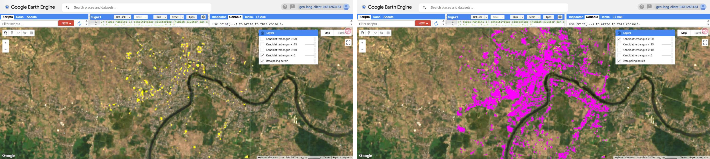

Gambar T1. Kandidat terbangun k = 5 (kiri) dan k = 20 (kanan), seed bawaan

Jumlah cluster paling berpengaruh di nilai kecil. Dengan k = 5 luas kandidat terbangun berubah dari 41 Ha ke 347 Ha hanya karena seed diganti, karena dengan lima kelompok permukiman tercampur di ketiga seed dengan kelas lain, kadang ikut tanah terbuka, kadang hanya atap paling terang. mulai k = 10 hasilnya lebih stabil di 485 sampai 779 Ha, dan peta k = 20 sudah menangkap hampir seluruh kota Cepu

Nomor cluster tidak stabl sama sekali. Untuk k = 15 kelompok terbangun bernomor 9, 10, 11 di seed bawaan, lalu 1, 6, 14 di seed 1, lalu 3, 4, 6, 12 di seed 2. Kode seperti `hasil.eq(2).or(hasil.eq(3))` di modul hanya benar untuk satu kali pelatihan, jadi nomor cluster harus dipilih ulang setiap model dilatih ulang

### Tugas 2: Kalibrasi Ambang NDBI

Data titik memakai sepuluh titk Inspector dari Task II. NDBI lima titik terbangun ada di 0,076 sampai 0,151 dan lima titik bukan terbangun di −0,398 sampai −0,107. Ambang baru diambil dari titik tengah antara nilai terbangun terkecil dan bukan terbangun terbesar, −0,016, dibulatkan jadi −0,02.

| ambang NDBI | luas terbangun Jabodetabekpunjur (Ha) |
| --- | --- |
| > −0,1 (modul) | 175.563 |
| > −0,02 (kalibrasi) | 112.742 |
| selisih | −62.821 (−35,8%) |

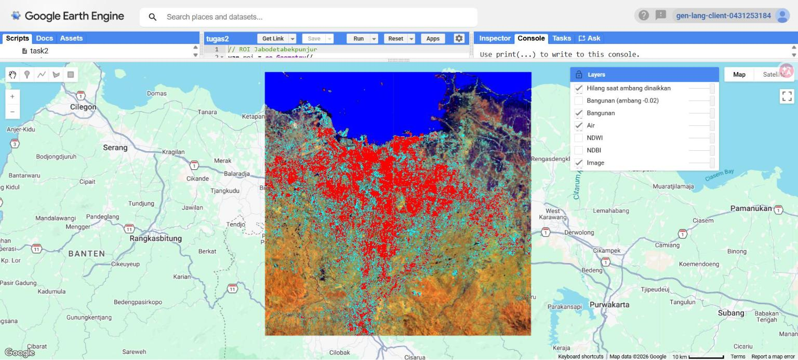

Gambar T2. Merah = terbangun dengan ambang −0,1, cyan = piksel yang hilang saat ambang dinaikkan ke −0,02

Ambang −0,02 memisahkan kesepuluh titik itu dengan selisih paling lebar, tapi luas terbangun turun 35,8% dibanding ambang −0,1. Piksel yang hilang (cyan) hampir semua ada di tepi kawasan kota dan permukiman pinggiran, sementara inti Jakarta tetap. titik kalibrasi sengaja dipilih yang paling jelas, jadi ambang dari titik ekstrem seperti ini cenderung terlalu ketat untuk permukiman campuran

Perbandingan dengan WorldCover di Task II memberi gambaran yang sama: makin tinggi ambang makin tinggi presisi, tapi makin banyak permukiman yang hilang. Pilihan ambang bergantung tujuan petanya, dan untuk menghitung luas kota −0,1 tetap lebih seimbang

### Tugas 3: Urban Sprawl Kota Bandung

ROI dipindah ke Kota Bandung dan sekitarnya termasuk Cimahi (107,50-107,75 BT; 6,83-7,02 LS), `yearList` ditambah 2024, dan band luas memakai perbaikan `built.gt(0)`.

| tahun | 1990 | 1995 | 2000 | 2005 | 2010 | 2015 | 2020 | 2024 |
| --- | --- | --- | --- | --- | --- | --- | --- | --- |
| luas (Ha) | 11.772 | 13.917 | 18.278 | 19.522 | 20.153 | 29.505 | 24.672 | 26.105 |

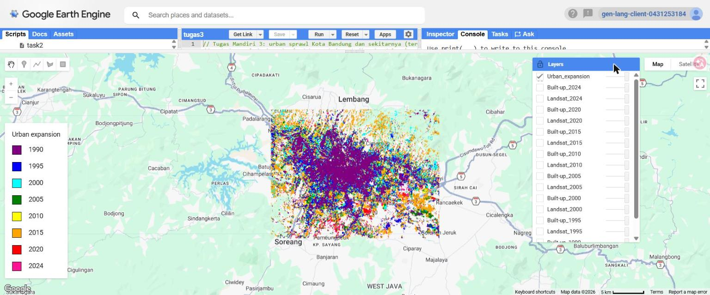

Gambar T3a. Peta ekspansi Bandung 1990-2024

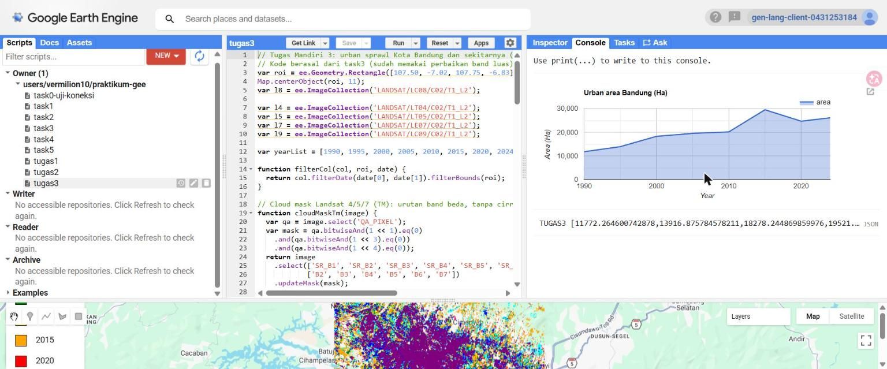

Gambar T3b. Grafik luas lahan terbangun Bandung

Inti kota Bandung dan Cimahi sudah terbangun di 1990, lalu perluasan bergerak ke tenggara ke arah Bojongsoang dan Rancaekek, ke utara di kaki bukit, dan di 2024 ada bercak baru di selatan. Luasnya naik dari 11.772 Ha di 1990 ke 26.105 Ha di 2024

Polanya sama dengan Jabodetabekpunjur: lonjakan besar tepat di 2015 lalu turun di 2020. Dua kota yang berbeda menunjukkan lompatan di tahun yang sama, yaitu tahun pertama komposit memakai sensor OLI, jadi sebagian lonjakan itu lebih mungkin berasal dari pergantian sensor daripada pembangunan baru

### Tugas 4: Risiko Tiga Komponen

Skrip `tugas4` = `task5` ditambah `.add(harkatKerentanan)`. Karena jumlahnya sekarang 3 sampai 15, ambang risiko diganti mengikuti Tabel 10: 3-6 kelas 2, 7-9 kelas 3, 10-12 kelas 4, > 12 kelas 5. kelas 1 (< 3) tidak mungkin terisi karena jumlah minimumnya 3. Luas tiap kelas dihitung dengan `reduceRegion` bertingkat, yaitu `ee.Reducer.sum().group({groupField: 1, groupName: 'kelas'})` pada luas piksel yang diberi band kelas:

| kelas | 2 komponen (Ha) | 3 komponen (Ha) |
| --- | --- | --- |
| 1 | 11.509 | 0 |
| 2 | 47.360 | 38.549 |
| 3 | 10.276 | 30.546 |
| 4 | 153 | 203 |
| 5 | 0 | 0 |

Perpindahan kelas: 1→2 11.509 Ha, 2→2 27.040 Ha, 2→3 20.320 Ha, 3→3 10.226 Ha, 3→4 50 Ha, 4→4 153 Ha. Tidak ada piksel yang turun kelas.

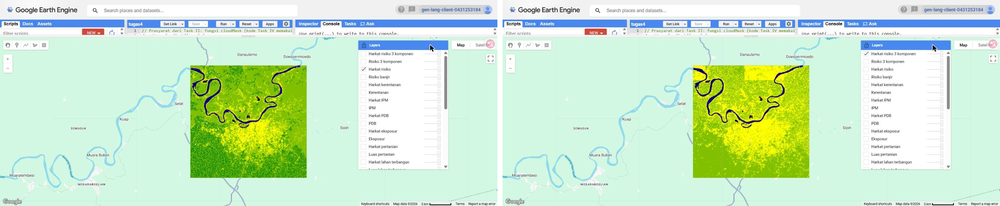

Gambar T4. Harkat risiko dua komponen (kiri) dan tiga komponen (kanan)

Menambahkan kerentanan membuat 31.879 Ha naik satu kelas dan tidak ada yang turun. Kerentanan di ROI hampir seragam, 94,5% kelas 3, jadi penambahannya bekerja seperti menambah konstanta sekitar 3 ke semua piksel. urutan relatif antarwilayah hampir tidak berubah, yang berubah adalah label kelasnya karena ambang Tabel 10 dipakai pada rentang yang lebih lebar

Di peta tiga komponen muncul blok persegi besar yang tidak ada di versi dua komponen. Blok itu batas sel PDB dan IPM yang beresolusi sekitar 5 km, jadi kerentanan menambahkn pola sel data, bukan informasi baru tentang wilayah. Untuk ROI seukuran kota, komponen kerentanan dari data ini belum memberi pembeda yang berarti

---

## Soal HOTS

Dua problem yang dikerjakan untuk laporan ini adalah A dan B, keduanya di skrip `hotsAB`.

### Problem A: Detektif Bit QA

```js
function jumlahBit(image) {
  var qa = image.select('QA_PIXEL');
  return qa.bitwiseAnd(1 << 1).gt(0)
    .add(qa.bitwiseAnd(1 << 2).gt(0))
    .add(qa.bitwiseAnd(1 << 3).gt(0))
    .add(qa.bitwiseAnd(1 << 4).gt(0));
}

// mask modul: tolak kalau minimal satu bit menyala
function cloudMask(image) {
  return skala(image).updateMask(jumlahBit(image).eq(0));
}

// problem A: tolak hanya kalau minimal dua bit menyala
function maskAwanKustom(image) {
  return skala(image).updateMask(jumlahBit(image).lt(2));
}
```

Tiap `bitwiseAnd(...).gt(0)` bernilai 1 kalau bitnya menyala, lalu keempatnya dijumlahkan. Mask modul ditulis ulang dengan `jumlahBit` yang sama supaya keduanya bisa dibandingkan langsung: modul meloloskan piksel dengan jumlah 0, mask kustom meloloskan jumlah di bawah 2. Jumlah observasi valid per piksel dihitung dengan `.sum()` atas koleksi biner tersebut.

| ukuran (44 citra landsat 8, 2022) | mask modul (tolak ≥ 1 bit) | mask kustom (tolak ≥ 2 bit) |
| --- | --- | --- |
| rata rata observasi valid per piksel | 7,50 | 13,36 (+78%) |
| median band biru komposit | 0,0449 | 0,0527 |
| persentil 99 band biru komposit | 0,119 | 0,166 |

Observasi yang diselamatkan mask custom (tepat satu bit menyala), rata rata per piksel: cloud saja 3,78, cirrus saja 1,07, shadow saja 0,78, dilated saja 0,23.

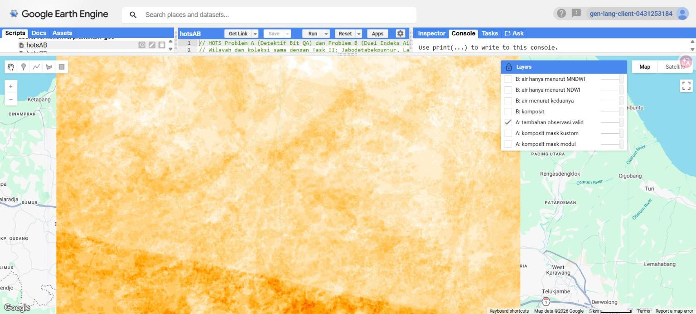

Gambar A. Tambahan observasi valid per piksel (mask kustom dikurangi mask modul)

Mask custom hampir menggandakan observasi valid, dari 7,50 ke 13,36 per piksel, dan tambahan paling banyak ada di selatan yang lebih sering berawan. Tapi 64% observasi yang diselamatkan adalah piksel yang bit cloud-nya menyala sendirian, jadi yang masuk lagi sebagian besar memang awan, hanya tanpa tanda dilated atau bayangan. Akibatnya terlihat di komposit: persentil 99 band biru naik dari 0,119 ke 0,166, tanda ada sisa awan terang yang lolos median

Mask custom berguna untuk daerah yang hampir selalu berawan dan kekurangan observasi. Untuk komposit setahun di Jabodetabekpunjur, mask modul yang ketat sudah cukup dan hasilnya lebih bersih

### Problem B: Duel Indeks Air

Luas air NDWI dan MNDWI dengan ambang 0,1 dihitung dengan `reduceRegion` + `ee.Reducer.sum()` pada komposit Task II. Di 26.036 Ha NDWI kosong (masked) tapi MNDWI terbaca air, karena band NIR tidak bernilai di piksel itu, kemungkinan laut gelap. perbandingan di bawah hanya di piksel tempat keduanya bernilai, dan tipe tutupan diambil dari WorldCover.

| ukuran | luas (Ha) |
| --- | --- |
| air menurut NDWI > 0,1 | 68.185 |
| air menurut MNDWI > 0,1 | 84.074 |
| selisih (MNDWI − NDWI) | 15.889 |
| hanya MNDWI | 17.199 (sawah 7.111, badan air 8.762, lahan basah 850, lainnya 476) |
| hanya NDWI | 1.311 (badan air 1.310, terbangun 0,6) |

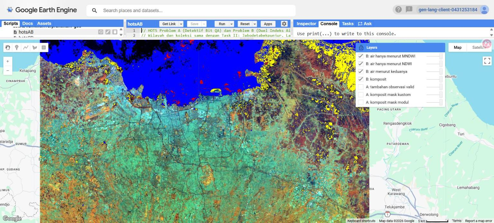

Gambar B. Biru = air menurut keduanya, merah = hanya NDWI, kuning = hanya MNDWI

MNDWI menangkap air 15.889 Ha lebih banyak dari NDWI di komposit yang sama. Area yang hanya terbaca MNDWI terkumpul di pesisir timur laut, yaitu tambak dan sawah tergenang (7.111 Ha di kelas pertanian WorldCover) dan badan air keruh. SWIR diserap air jauh lebih kuat dari NIR, jadi air keruh atau dangkal yang NIR-nya masih memantul tetap terbaca sebagai air oleh MNDWI

Xu (2006) mengusulkan MNDWI karena NDWI sering membaca latar terbangun sebagai air. Di komposit ini salah deteksi itu ternyata kecil: hanya 0,6 Ha piksel terbangun yang terbaca air oleh NDWI saja. Pada ambang 0,1 dan komposit median setahun, keunggulan MNDWI di Jabodetabekpunjur lebih terlihat di air keruh dan sawah daripada di kota

---

## Catatan Perbedaan dengan Modul

Hal yang dikerjakan berbeda dari kode atau teks modul, berikut alasannya:

| bagian | di modul | yang dipakai | alasan |
| --- | --- | --- | --- |
| uji koneksi | `ee.Image('.../LC09_122065_20220119')` | filter koleksi + `limit(1)` | ID scene tidak ditemukan di katalog |
| task I | `hasil.eq(2).or(hasil.eq(3))` | `hasil.eq(9).or(hasil.eq(11))` | nomor cluster berubah tiap pelatihan, dipilih ulang lewat statistik dan cek visual |
| task I | lokasi Purwodadi | Cepu | poligon kajian jatuh di Cepu menurut label peta |
| task III | `l8` tidak didefinisikan | ditambah `var l8 = ...` | error kalau skrip dijalankan terpisah dari Task II |
| task III | `built.multiply(...)` | `built.gt(0).multiply(...)` | luas terkali tahun, 143 juta Ha untuk 1990 |
| task III | sumbu X tanpa format | `format: '####'` | tahun tertulis "1,990" |
| task IV | `cloudMask` tidak didefinisikan | disalin dari Task II | sesuai catatan "identik Task II" di modul |
| task IV | layer NDWI tidak ditambahkan | ditambah `Map.addLayer(ndwi, ...)` | diminta Gambar 10 |
| task V | tiga layer tidak ditambahkan | ditambah | diminta Gambar 17 dan 18 |
| task V | `reduceResolution(ee.Reducer.sum(), true)` | tidak diubah, dibahas | maksimum 85,45 m² per sel, kelas 5 tidak pernah tercapai |
| tabel 5, 7, 9 | kelas 1 di bawah jumlah minimum | kode modul (`lte`) | kelas 1 versi tabel tidak mungkin terisi |
| tabel 10 | ambang tiga komponen | ambang 2/4/6/8 di Task V, Tabel 10 di Tugas 4 | kode modul menjumlahkan dua komponen |
| gambar 20 | legenda kelas terbaca | tanpa panel legenda | kode modul tidak membuat legenda risiko |

---

## Kesimpulan

| studi kasus | metode | hasil utama | catatan |
| --- | --- | --- | --- |
| tutupan lahan Cepu | clustering k-means, k = 15 | cluster 9 dan 11 dipilih sebagai terbangun, 497,8 Ha | nomor cluster berubah tiap seed; k = 5 tidak stabil (41-347 Ha) |
| lahan terbangun Jabodetabekpunjur 2022 | NDBI > −0,1 dan NDWI ≤ 0,1 | presisi 85%, recall 78% terhadap WorldCover | ambang modul dipertahankan sesudah kalibrasi |
| urban sprawl 1990-2020 | nilai tahun + `min()` | 72.060 Ha (1990) ke 180.747 Ha (2020) | grafik turun di 2020, kemungkinan efek pergantian sensor |
| risiko banjir Batanghari | harkat multikriteria | risiko 68,3% kelas 2, tanpa kelas 5 | bug luas eksposur dan data kerentanan ±5 km |

1. Pola filter, map, reduce, visualize berlaku di keempat studi kasus, dari satu citra Landsat 9 sampai tujuh komposit dari lima satelit

2. Dua bug di kode modul (band luas Task III dan `reduceResolution` Task V) tidak terlihat dari tampilan peta atau bentuk grafik. keduanya baru ditemukan sesudah angkanya dibandingkan dengan besaran yang sudah diketahui, yaitu luas ROI sekitar 600 ribu Ha dan luas sel 30 m sekitar 900 m²

3. Ambang menentukan hasil model harkat sebesar datanya sendiri. Ambang jarak 200 m membuat 93,6% ROI berharkat 1, ambang TPI 0,25 m lebih halus dari data SRTM, dan ambang luas eksposur yang bertemu bug satuan membuat kelas risiko 5 tidak pernah muncul

4. Data sosial ekonomi beresolusi 5 km hampir tidak membedakan apa pun di ROI seukuran kota: IPM 100% kelas 4 dan kerentanan 94,5% kelas 3. Menambahkan komponen itu menaikkan kelas 31.879 Ha secara merata tanpa mengubah urutan risiko antarwilayah

---

## Daftar Pustaka

Geosoftware.ID Team. (2025). *Intermediate GEE*. Geosoftware.ID. https://geosoftwareid.com

Gorelick, N., Hancher, M., Dixon, M., Ilyushchenko, S., Thau, D., & Moore, R. (2017). Google Earth Engine: Planetary-scale geospatial analysis for everyone. *Remote Sensing of Environment*, 202, 18-27.

USGS. (2021). *Landsat Collection 2 Level-2 Science Product Guide*. U.S. Geological Survey.

Xu, H. (2006). Modification of normalised difference water index (NDWI) to enhance open water features in remotely sensed imagery. *International Journal of Remote Sensing*, 27(14), 3025-3033.

Zanaga, D., Van De Kerchove, R., De Keersmaecker, W., dkk. (2021). *ESA WorldCover 10 m 2020 v200*. Zenodo.
