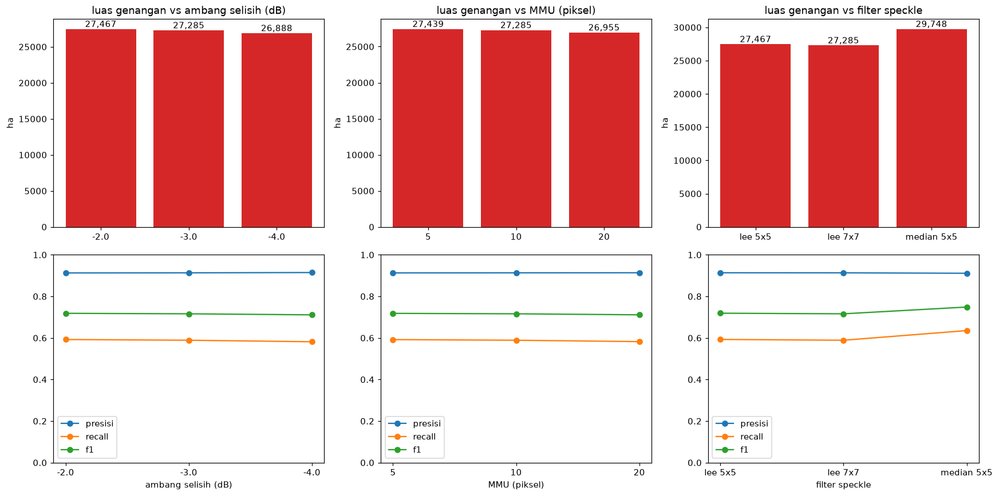
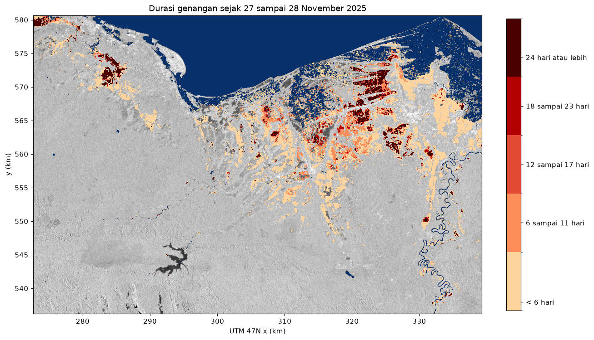

# Progress Pra-Tubes

Topik: pemetaan genangan banjir pasca-Siklon Senyar di Aceh Utara dan Lhokseumawe dari Sentinel-1. proposal lengkap di `proposal-pratubes.md`

| minggu | tanggal | yang dikerjakan | hasil utama |
| --- | --- | --- | --- |
| 1 | 22 Oktober 2026 | proposal topik, notebook preprocessing sampai peta genangan | 27.285 ha genangan baru, OA 0,886 dan kappa 0,711 terhadap Sentinel-2 |
| 2 | 29 Oktober 2026 | uji sensitivitas tiga parameter preprocessing | filter speckle paling berpengaruh (9,0%), ambang selisih dan MMU di bawah 2,2% |
| 3 | 4 November 2026 | durasi genangan dari deret waktu Sentinel-1 Desember 2025 | 68,6% surut dalam 6 hari, 3.098 ha bertahan 24 hari atau lebih |

---

## 22 Oktober 2026, Proposal dan Notebook Preprocessing

Notebook `notebook/pratubes-banjir-senyar.ipynb` mengerjakan pencarian scene, konversi dB, perbandingan filter speckle, Otsu, change detection, masking, morfologi, penggabungan dua orbit, dan validasi dengan MNDWI Sentinel-2. semua data dibaca dari Planetary Computer tanpa akun GEE

Hasilnya 27.285 ha genangan baru pada 27 sampai 28 November 2025, 85% di lahan pertanian. terhadap Sentinel-2 29 November: OA 0,886, kappa 0,711, presisi 0,905, recall 0,697

## 29 Oktober 2026, Uji Sensitivitas Parameter

Notebook `notebook/sensitivitas-parameter.ipynb` menjalankan ulang pipeline dengan 27 kombinasi: ambang selisih (-2, -3, -4 dB), MMU (5, 10, 20 piksel), dan filter (Lee 5x5, Lee 7x7, median 5x5). data dibaca dari cache, jadi tidak ada unduhan baru

| parameter diubah | rentang luas | perubahan dari dasar |
| --- | --- | --- |
| ambang selisih -2 sampai -4 dB | 26.888 sampai 27.467 ha | 2,1% |
| MMU 5 sampai 20 piksel | 26.955 sampai 27.439 ha | 1,8% |
| filter Lee 5x5, Lee 7x7, median 5x5 | 27.285 sampai 29.748 ha | 9,0% |

Ambang selisih dan MMU hampir tidak menggeser hasil, jadi nilai di notebook utama aman dipertahankan. filter yang paling menentukan. median 5x5 memberi luas sekitar 9% lebih besar dengan presisi terhadap Sentinel-2 yang sama (0,911 dan 0,913) dan recall lebih tinggi (0,635 dan 0,589), jadi alasan memilih Lee 7x7 di notebook utama perlu ditinjau ulang. notebook utama belum diubah karena referensi MNDWI memakai band SWIR 20 m yang juga tidak bisa melihat pematang sempit

## 4 November 2026, Durasi Genangan

Notebook `notebook/durasi-genangan.ipynb` menerapkan pipeline yang sama ke empat scene Desember 2025 dari tiap orbit (3, 9, 15, 21 Desember untuk orbit 41 dan 4, 10, 16, 22 Desember untuk orbit 143), dengan ambang Otsu tanggal saat banjir. luas di tanggal saat banjir sama dengan notebook utama, 27.285 ha

| durasi | luas (ha) | persen |
| --- | ---: | ---: |
| kurang dari 6 hari | 18.707 | 68,6% |
| 6 sampai 11 hari | 3.782 | 13,9% |
| 12 sampai 17 hari | 709 | 2,6% |
| 18 sampai 23 hari | 989 | 3,6% |
| 24 hari atau lebih | 3.098 | 11,4% |

Genangan surut cepat, enam hari sesudah banjir luasnya tinggal sekitar 30%. yang bertahan 24 hari atau lebih hampir semuanya lahan pertanian dan berbentuk petak persegi dekat pesisir. belum bisa dipastikan apakah itu genangan banjir yang tertahan atau petak sawah dan tambak yang memang sengaja digenangi, radar saja tidak bisa membedakannya. luas sempat naik lagi pada 15 sampai 16 Desember, kemungkinan dari hujan susulan atau pengairan sawah

Rencana berikutnya: luas genangan per kecamatan, lalu memeriksa petak yang bertahan lama dengan citra tanggal yang sama tahun sebelumnya
