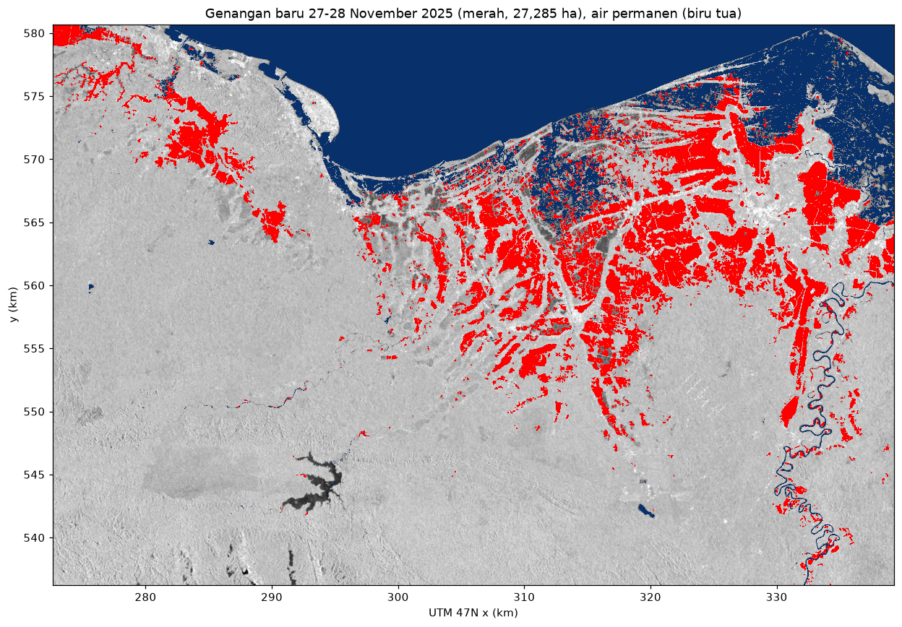

# Draft Proposal Topik Pra-Tubes

Pemetaan Genangan Banjir Pasca-Siklon Senyar di Kabupaten Aceh Utara dan Kota Lhokseumawe dari Citra Sentinel-1 SAR Menggunakan Filter Speckle, Thresholding Otsu, dan Change Detection

| | |
| --- | --- |
| nama | Fathin Y |
| NIM | 241524041 |
| kelas | 3B |
| mata kuliah | Pengolahan Citra Digital, semester 5 |
| status | draft, menunggu ketentuan pra-tubes diumumkan |
| notebook | `p6-pratubes-22102026/notebook/pratubes-banjir-senyar.ipynb` |

---

## Latar Belakang

Siklon tropis Senyar terbentuk di Selat Malaka pada malam 25 ke 26 November 2025 dan mendarat di Sumatra keesokan harinya (EU Space, 2025). sampai 28 November, BNPB mencatat 174 korban meninggal dan 79 orang hilang di Aceh, Sumatera Utara, dan Sumatera Barat. di Lhokseumawe sendiri tercatat satu korban meninggal dan tiga orang hilang (Investortrust, 2025)

Citra Sentinel-2 tanggal 29 November 2025 memperlihatkan kota Lhoksukon dan Panton Labu di Aceh Utara dikelilingi air (EU Space, 2025), tapi citra optik seperti ini hanya bisa dipakai kalau langit cerah, sementara selama siklon wilayah ini hampir selalu tertutup awan. Sentinel-1 membawa radar C-band yang tembus awan dan tetap merekam di malam hari. permukaan air yang tenang memantulkan sinyal radar menjauh dari sensor, jadi air tampak gelap di citra, dan sifat ini yang dipakai untuk memisahkan genangan dari daratan

Pendekatan ini sudah dipakai di wilayah yang sama. Budiarto dan Bioresita (2023) memetakan banjir Aceh Utara Oktober 2022 dari Sentinel-1 polarisasi VH dengan change detection di Google Earth Engine, hasilnya 12.331 ha pada 8 Oktober dan 6.070 ha pada 20 Oktober dengan akurasi 97% dan 98%. Tiwari dkk. (2020) memakai thresholding Otsu pada Sentinel-1 untuk banjir Kerala 2018 dengan akurasi keseluruhan 94,3% dan 94,1%. Untuk kejadian Senyar, Mulyani dkk. (2026) memadukan genangan Sentinel-1 dengan data lahan baku sawah dan mendapat sekitar 102.189 ha sawah terdampak di Aceh bagian timur dan Sumatera Utara

Ketiga penelitian tersebut berfokus pada hasil akhir berupa luas genangan. Pilihan di tahap preprocessing, misalnya filter speckle yang dipakai dan cara menentukan ambang, jarang dibandingkan secara terkur, padahal pilihan ini yang menentukan bentuk histogram dan akhirnya luas genangan. Sebagian besar juga dikerjakan di Google Earth Engine atau ArcGIS. Penelitian ini mengerjakan seluruh tahap dengan Python (OpenCV, scikit-image) dan data terbuka dari Microsoft Planetary Computer, jadi setiap operasi pengolahan citra ditulis dan bisa diperiksa langusng

Topik ini juga menyambung ke dua klaster dari daftar topik awal: klaster 4 menyebut pariwisata Lhokseumawe yang lesu pasca bencana, dan klaster 1 menyoroti ketahanan pangan, di sini dalam bentuk sawah yang tergenang

## Rumusan Masalah

1. Filter speckle mana yang paling baik memisahkan air dan bukan air pada citra VV Sentinel-1 di lokasi ini, diukur dengan ENL (equivalent number of looks) dan rasio varians antar kelas Otsu (η)?
2. Berapa luas genangan baru pada 27 sampai 28 November 2025 di area studi, hasil gabungan thresholding Otsu, change detection, masking, dan operasi morfologi?
3. Seberapa sesuai peta air dari Sentinel-1 dengan peta air dari MNDWI Sentinel-2 tanggal 29 November 2025 pada piksel yang bebas awan?
4. Tutupan lahan apa yang paling luas tergenang?

## Batasan

- Area studi berupa bounding box 96,95° sampai 97,55° BT dan 4,85° sampai 5,25° LU (sekitar 66 x 44 km), mencakup Lhokseumawe sampai Panton Labu. belum dipotong batas administrasi
- Citra utama Sentinel-1 RTC polarisasi VV dan VH resolusi 20 m. dua pasang orbit dipakai karena tidak ada satu orbit yang menutup seluruh area studi pada 27 sampai 28 November: orbit 41 (15 dan 27 November) di bagian barat, orbit 143 (16 dan 28 November) di bagian timur
- Fokus tugas ini sampai tahap preprocessing dan peta genangan berbasis aturan (rule based). tidak ada training model
- Validasi memakai Sentinel-2 karena tidak ada data lapangan, jadi angka kesesuaian bukan akurasi lapangan

## Data

| data | sumber | resolusi | kegunaan |
| --- | --- | --- | --- |
| Sentinel-1 RTC, VV dan VH | Planetary Computer, `sentinel-1-rtc` | 10 m, dibaca 20 m | citra sebelum dan saat banjir |
| Sentinel-2 L2A | Planetary Computer, `sentinel-2-l2a` | 10 sampai 20 m | validasi MNDWI, 29 November 2025 |
| ESA WorldCover 2021 v200 | Planetary Computer, `esa-worldcover` | 10 m | mask air permanen, luas per tutupan lahan |
| Copernicus DEM GLO-30 | Planetary Computer, `cop-dem-glo-30` | 30 m | mask lereng |

Semua data dibaca lewat API STAC dengan `pystac-client` dan `odc-stac`, tanpa akun Google Earth Engine. catatan: halaman koleksi `sentinel-1-rtc` menyebut akun Planetary Computer diperlukan, tapi saat diuji 22 Oktober 2026 data terbaca tanpa akun. kalau aksesnya ditutup, akun Planetary Computer gratis cukup untuk membukanya lagi

## Metode

| tahap | operasi | alat |
| --- | --- | --- |
| 1. pencarian scene | filter STAC per tanggal dan orbit relatif, hitung cakupan area studi | `pystac-client`, `shapely` |
| 2. pembacaan dan resampling | 10 m ke 20 m dengan rata rata 2x2 (multilook), grid UTM 47N yang sama untuk semua data | `odc-stac` |
| 3. konversi radiometrik | linear ke desibel, `10·log10(γ0)`, mask no-data | `numpy` |
| 4. filter speckle | perbandingan mean, gaussian, median, Lee 5x5 dan Lee 7x7, diukur dengan ENL dan η Otsu | `cv2` |
| 5. thresholding | Otsu pada histogram VV citra saat banjir di luar air permanen, ambang yang sama dipakai untuk citra sebelum banjir di orbit yang sama | `skimage.filters.threshold_otsu` |
| 6. change detection | selisih dB saat dikurangi sebelum, genangan baru jika selisih < -3 dB dan bukan air sebelumnya | `numpy` |
| 7. masking | air permanen (WorldCover kelas 80) dan lereng > 5° dari DEM yang dihaluskan rata rata 9x9 | `cv2`, `numpy` |
| 8. morfologi | opening 3x3, connected component, buang komponen < 10 piksel (0,4 ha) | `cv2` |
| 9. penggabungan orbit | orbit 41 diutamakan, sisanya orbit 143, irisan dipakai untuk uji konsistensi | `numpy` |
| 10. validasi | MNDWI Sentinel-2 + Otsu di piksel cerah (SCL), confusion matrix, OA, kappa, F1 | `numpy` |
| 11. analisis awal | luas genangan per kelas WorldCover | `numpy` |

Filter Lee (Lee, 1980) dipilih sebagai kandidat utama karena bobotnya bergantung pada statistik lokal: di area homogen piksel diganti rata rata tetangga, di tepi objek nilai asli dipertahankan. Otsu (1979) dipilih karena ambang dihitung dari histogram citra itu sendiri, jadi tidak perlu ambang tetap yang belum tentu cocok untuk tanggal dan orbit lain. MNDWI (Xu, 2006) dipakai untuk validasi karena memakai band SWIR yang lebih peka terhadap air terbuka dibanding NDWI

## Hasil Uji Kelayakan

Notebook sudah dijalankan penuh dengan data asli pada 22 Oktober 2026, jadi topik ini sudah terbukti bisa dikerjakan sampai peta genangan. hasil sementaranya:

| tahap | hasil |
| --- | --- |
| filter speckle | ENL naik dari 19,65 (tanpa filter) ke 155,42 (Lee 7x7). η tertinggi median 5x5 (0,830) tapi jalan dan pematang ikut hilang, jadi yang dipakai Lee 7x7 (η 0,775) |
| Otsu citra saat banjir, VV | -12,2 dB (orbit 41) dan -12,8 dB (orbit 143), η 0,77 dan 0,79 |
| Otsu citra sebelum banjir, VV | -8,1 dan -8,6 dB dengan η 0,46 dan 0,44. histogramnya satu puncak, ambang ini tidak dipakai |
| genangan baru gabungan | 27.285 ha, 23.162 ha (85%) di lahan pertanian |
| konsistensi dua orbit | IoU 0,51 di irisan 73.576 ha |
| validasi Sentinel-2, 145.523 ha piksel cerah | OA 0,886, kappa 0,711, presisi 0,905, recall 0,697, F1 0,787 |

Tiga temuan dari uji ini yang akan dibahas lebih dalam di tugas besar:

1. Otsu selalu mengembalikan satu ambang walau histogramnya tidak punya dua puncak. di citra sebelum banjir ambangnya jatuh di dalam puncak daratan dan membelah daratan jadi dua kelompok. masalah ini baru terlihat sesudah histogram dan η diperiksa, dari peta saja tidak kelihatan. solusinya memakai ambang citra saat banjir untuk kedua tanggal di orbit yang sama
2. Recall 0,697 berarti sekitar 30% air yang terlihat di Sentinel-2 terlewat. dari air yang hanya terdeteksi Sentinel-2, 46,7% ada di kelas pohon dan 35,9% di lahan pertanian, dan kelas terbangun hanya 16 ha tergenang padahal Lhoksukon terlihat dikelilingi air. ketiganya mengarah ke double bounce di genangan bervegetasi dan permukimann
3. WorldCover 2021 memberi label air permanen pada kawasan tambak di pesisir timur, jadi genangan di kawasan itu tidak terhitung. sebaliknya waduk di bagian selatan kotak studi tidak ada di WorldCover tapi tetap tidak terdeteksi sebagai genangan, karena sudah gelap di citra sebelum banjir. syarat bukan air sebelumnya ternyata ikut menutupi kekurangan mask

## Pengembangan Sesudah Preprocessing

Topik ini tidak harus berhenti di thresholding. beberapa arah lanjutan yang datanya sudah tersedia di katalog yang sama:

| arah | isi | butuh training |
| --- | --- | --- |
| durasi genangan | scene 3, 9, dan 10 Desember 2025 dari orbit yang sama untuk melihat genangan surut per piksel | tidak |
| luas per kecamatan | memotong peta dengan batas administrasi lalu dibandingkan dengan laporan BPBD | tidak |
| uji model kerawanan | membandingkan peta kerawanan banjir multikriteria seperti di praktikum P5 dengan genangan nyata Senyar | tidak |
| klasifikasi klasik | Random Forest atau SVM dengan fitur VV, VH, rasio VV/VH, dan tekstur GLCM, label dari MNDWI Sentinel-2 di piksel cerah | ya, ringan |
| deep learning | segmentasi U-Net dilatih dengan dataset Sen1Floods11 (Bonafilia dkk., 2020) yang berisi 4.831 chip dari 11 kejadian banjir, lalu diuji di Aceh Utara, dengan hasil Otsu sebagai baseline | ya |

Kalau ketentuan tubes nanti tidak meminta training, tiga baris pertama sudah cukup sebagai analisis lanjutan. kalau meminta, baris klasifikasi klasik paling realsitis dikerjakan sendiri karena labelnya bisa dibuat otomatis dari Sentinel-2, tanpa digitasi manual

## Risiko

| risiko | dampak | rencana |
| --- | --- | --- |
| akses `sentinel-1-rtc` butuh akun | data tidak bisa dibaca | daftar akun Planetary Computer gratis, cache `.npz` di `data/` sudah tersimpan |
| genangan di permukiman | dinding bangunan dan air memantulkan sinyal balik ke sensor (double bounce), jadi permukiman tergenang tampak terang dan tidak terdeteksi | dicatat sebagai keterbatsan, dibandingkan dengan kelas terbangun WorldCover |
| genangan di bawah vegetasi | efek yang sama di sawah dan kebun yang tergenang | sama seperti di atas |
| jeda waktu validasi | Sentinel-2 29 November, Sentinel-1 27 dan 28 November | hasil validasi disebut kesesuaian, bukan akurasi |
| tambak dan sawah yang memang tergenang | ikut gelap di kedua tanggal | sudah dikeluarkan lewat syarat bukan air sebelumnya |

## Daftar Pustaka

Bonafilia, D., Tellman, B., Anderson, T., & Issenberg, E. (2020). Sen1Floods11: A georeferenced dataset to train and test deep learning flood algorithms for Sentinel-1. *2020 IEEE/CVF Conference on Computer Vision and Pattern Recognition Workshops (CVPRW)*, 835-845. https://doi.org/10.1109/CVPRW50498.2020.00113

Budiarto, F. A., & Bioresita, F. (2023). Pemanfaatan citra Sentinel-1 SAR dan metode change detection approach untuk analisis sebaran spasial wilayah banjir dan area terdampak (studi kasus: banjir Kabupaten Aceh Utara 2022). *JGISE: Journal of Geospatial Information Science and Engineering*, 6(2). https://doi.org/10.22146/jgise.87585

DeVries, B., Huang, C., Armston, J., Huang, W., Jones, J. W., & Lang, M. W. (2020). Rapid and robust monitoring of flood events using Sentinel-1 and Landsat data on the Google Earth Engine. *Remote Sensing of Environment*, 240, 111664. https://doi.org/10.1016/j.rse.2020.111664

EU Space. (2025, 2 Desember). *Flooding in northern Sumatra, Indonesia*. EU Agency for the Space Programme. https://eu-space.europa.eu/components/earth-observation-copernicus/image-of-day/flooding-northern-sumatra-indonesia

Investortrust. (2025, 28 November). *Korban tewas siklon Senyar di Sumatra tembus 174 orang, 79 masih hilang*. https://investortrust.id/national/86957/korban-tewas-siklon-senyar-di-sumatra-tembus-174-orang-79-masih-hilang

Lee, J.-S. (1980). Digital image enhancement and noise filtering by use of local statistics. *IEEE Transactions on Pattern Analysis and Machine Intelligence*, PAMI-2(2), 165-168. https://doi.org/10.1109/TPAMI.1980.4766994

Mulyani, A., Hati, D. P., Manurung, E. D., dkk. (2026). Rapid identification of tropical cyclone Senyar-affected paddy fields in Sumatra using Sentinel-1 and official paddy field area data. *Theoretical and Applied Climatology*, 157, 615. https://doi.org/10.1007/s00704-026-06455-w

Otsu, N. (1979). A threshold selection method from gray-level histograms. *IEEE Transactions on Systems, Man, and Cybernetics*, 9(1), 62-66. https://doi.org/10.1109/TSMC.1979.4310076

Tiwari, V., Kumar, V., Matin, M. A., Thapa, A., Ellenburg, W. L., Gupta, N., & Thapa, S. (2020). Flood inundation mapping- Kerala 2018; Harnessing the power of SAR, automatic threshold detection method and Google Earth Engine. *PLOS ONE*, 15(8), e0237324. https://doi.org/10.1371/journal.pone.0237324

Xu, H. (2006). Modification of normalised difference water index (NDWI) to enhance open water features in remotely sensed imagery. *International Journal of Remote Sensing*, 27(14), 3025-3033. https://doi.org/10.1080/01431160600589179

Zanaga, D., Van De Kerchove, R., Daems, D., De Keersmaecker, W., Brockmann, C., dkk. (2022). *ESA WorldCover 10 m 2021 v200*. Zenodo. https://doi.org/10.5281/zenodo.7254221
